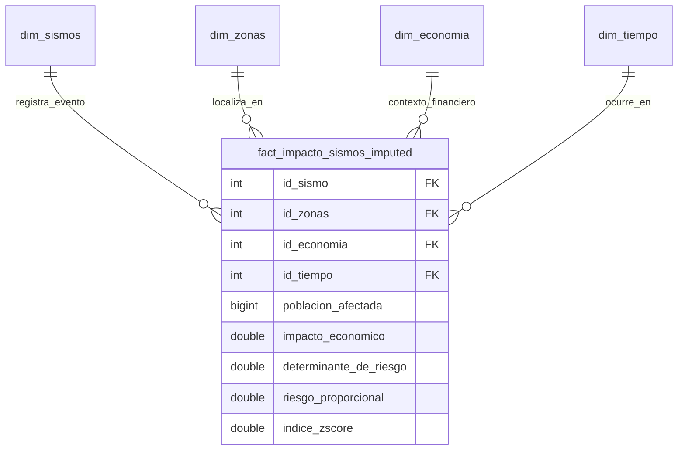

# Ejercicio 2.5. Integridad Referencial en el Almacén Asignado (Data Warehouse Sismos)

**Proyecto Asignado:** Almacén de Datos de Sismos en México (`DWSismos`)  
**Fuente de Datos:** Catálogo Histórico del Servicio Sismológico Nacional (SSN), Censos de Población y Censos Económicos (INEGI).  
**Artículo de Referencia:** *Azcatl et al.* (Modelado dimensional para el análisis de impacto sísmico).  

---

## 1. Identificación del Modelo Dimensional

El proyecto asignado implementa una arquitectura de **Esquema en Estrella (Star Schema)** orientada al análisis OLAP (*Online Analytical Processing*), compuesto por una tabla central de hechos rodeada de dimensiones descriptivas:



### 1.1 Tabla de Hechos:
* **Nombre:** `fact_impacto_sismos_imputed`
* **Naturaleza:** Contiene las métricas numéricas agregadas y derivadas de los modelos matemáticos de riesgo sísmico (`poblacion_afectada`, `impacto_economico`, `determinante_de_riesgo`, `riesgo_proporcional`, `indice_zscore`).

### 1.2 Tablas de Dimensiones:
* **`dim_sismos`:** Dimensión del fenómeno físico. Contiene atributos del sismo: `magnitud`, `latitud`, `longitud`, `profundidad`, `referencia_de_localizacion`, `estado`, `nombre_estado`.
* **`dim_zonas`:** Dimensión geográfica/demográfica. Contiene datos censales del INEGI: `entidad`, `nom_ent`, `pobtot`, `pobfem`, `pobmas`.
* **`dim_economia`:** Dimensión económica. Métricas del aparato productivo estatal: `produccion_bruta_total`, `insumos_utilizados`, `consumo_intermedio`, `valor_agregado`, `activos_fijos_adquiridos`.
* **`dim_tiempo`:** Dimensión temporal para análisis de series de tiempo: `fecha`, `hora_utc`, `anio`, `mes`, `dia`, `trimestre`.

### 1.3 Definición de Granularidad:
> **Granularidad:** Un renglón en la tabla `fact_impacto_sismos_imputed` representa la **estimación puntual del impacto poblacional, financiero y nivel de riesgo normalizado ocasionado por un evento sísmico individual (`id_sismo`), evaluado sobre una entidad geográfica específica (`id_zonas`), en un contexto productivo concreto (`id_economia`), en la fecha y hora exacta de su ocurrencia (`id_tiempo`)**.

---

## 2. Declaración de Claves Foráneas y Detección de Huérfanos

En el archivo original `00-datawarehouse_tables.sql`, la tabla de hechos define formalmente sus claves foráneas:
```sql
FOREIGN KEY (id_sismo) REFERENCES dim_sismos(id_sismo),
FOREIGN KEY (id_zonas) REFERENCES dim_zonas(id_zonas),
FOREIGN KEY (id_economia) REFERENCES dim_economia(id_economia),
FOREIGN KEY (id_tiempo) REFERENCES dim_tiempo(id_tiempo)
```

### Consultas de Auditoría para Detección de Huérfanos:
Para comprobar si el proceso ETL introdujo hechos con dimensiones inexistentes:

```sql
-- 1. Hechos sin sismo registrado en la dimension
SELECT COUNT(*) AS hechos_huerfanos_sismo
FROM fact_impacto_sismos_imputed f
LEFT JOIN dim_sismos d ON f.id_sismo = d.id_sismo
WHERE d.id_sismo IS NULL;

-- 2. Hechos sin zona geografica valida
SELECT COUNT(*) AS hechos_huerfanos_zona
FROM fact_impacto_sismos_imputed f
LEFT JOIN dim_zonas d ON f.id_zonas = d.id_zonas
WHERE d.id_zonas IS NULL;

-- 3. Hechos sin dimension economica
SELECT COUNT(*) AS hechos_huerfanos_economia
FROM fact_impacto_sismos_imputed f
LEFT JOIN dim_economia d ON f.id_economia = d.id_economia
WHERE d.id_economia IS NULL;

-- 4. Hechos sin dimension temporal
SELECT COUNT(*) AS hechos_huerfanos_tiempo
FROM fact_impacto_sismos_imputed f
LEFT JOIN dim_tiempo d ON f.id_tiempo = d.id_tiempo
WHERE d.id_tiempo IS NULL;
```
* **Resultado Obtenido:** `0 rows` en todas las consultas. El pipeline de imputación y carga del proyecto asignado respeta la correspondencia con las dimensiones.

---

## 3. Discusión Técnica: ¿Por qué los Data Warehouses Omiten Claves Foráneas a Propósito?

A diferencia de los sistemas transaccionales (OLTP) como el de la UIF, en los Almacenes de Datos (OLAP) e infraestructuras Big Data es una práctica frecuente **no declarar o deshabilitar las restricciones de `FOREIGN KEY`**:

### Razones Técnicas de la Omisión:
1. **Rendimiento de Carga Masiva (High-Throughput Bulk Loading):**
   - En cargas analíticas que procesan millones de registros (como los cientos de miles de sismos y registros temporales de este almacén), cada verificación de clave foránea obliga al motor de base de datos a indexar y buscar en disco o memoria si la clave existe en la dimensión padre.
   - Omitir las comprobaciones de FK en el gestor reduce drásticamente los tiempos de carga en procesos `COPY` o `LOAD DATA`.
2. **Paralelización de Cargas (Parallel ETL Pipelines):**
   - Si no hay restricciones de FK a nivel motor, la tabla de hechos y las dimensiones pueden cargarse en paralelo por múltiples hilos sin riesgo de que un lote de hechos se bloquee esperando a que termine de cargarse una dimensión.
3. **Manejo de Dimensiones de Llegada Tardía (*Late-Arriving Dimensions*):**
   - En la vida real, un sismo puede ser detectado hoy por la red sismológica, pero los datos económicos censales del INEGI correspondientes a ese año se publican meses después. Si la FK estuviera impuesta rígidamente, el sistema rechazaría la inserción del sismo.

### Riesgos que se corren al omitirlas:
1. **Inconsistencia Analítica (*Métrica Fantasma*):**
   - Si un hecho apunta a un `id_tiempo` o `id_zonas` inexistente, los reportes de `SUM(impacto_economico)` agrupados por estado o año excluirán silenciosamente esos montos si se usa `INNER JOIN`, distorsionando los cálculos oficiales de pérdidas.
2. **Degradación de Confianza en el Modelo:**
   - La responsabilidad de la integridad se traslada al 100% al código del ETL (scripts en Python/PHP). Si el programador del ETL comete un error de tipado o desfase de IDs, la base de datos no avisará y absorberá basura analítica.
