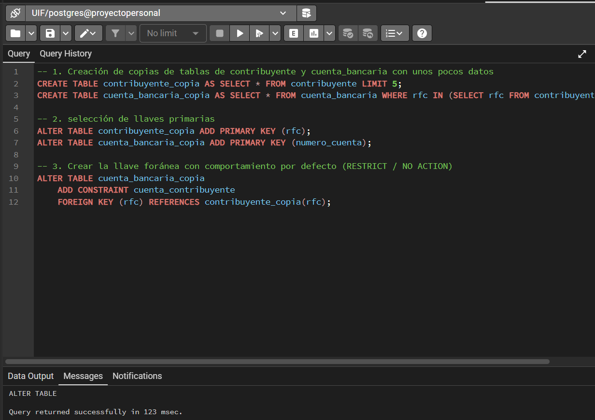
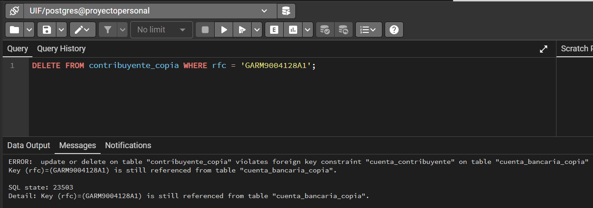
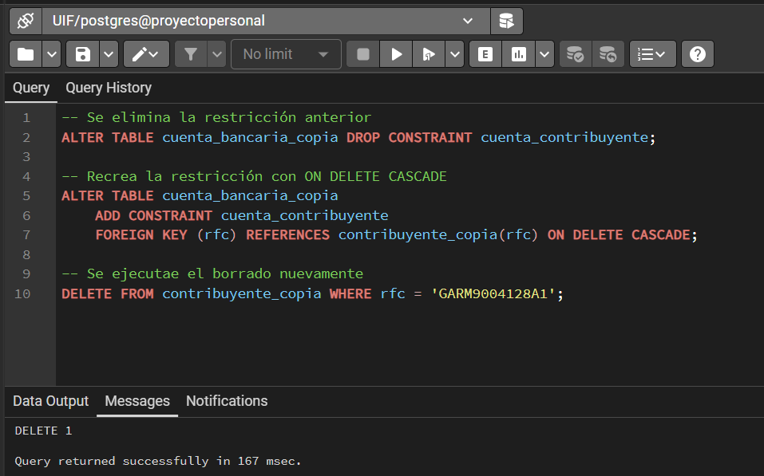

Para resolver este ejercicio se crearon copias de las tablas de contribuyente y cuenta_bancaria, pues estas incluyen ON DELETE CASCADE ON UPDATE CASCADE, luego se crean copias de las tablas y se añade una restricción que impide borrar ambas tablas si existe alguna tabla que dependa de ellas; cuenta_bancaria depende de contribuyente.

Para probar que información se conserva, extraemos un rfc de la tabla copiada con el comando SELECT rfc FROM contribuyente_copia LIMIT 1;, en este caso el rfc es: GARM9004128A1, y buscamos eliminarlo, teniendo en cuenta que de ese RFC depende la cuenta bancaria '9876543210987654'.

Luego eliminamos mediante comandos la restricción, volviendo posible eliminar los datos del contribuyente y al hacer esto, también se borran los datos asociados a este, por ejemplo: su cuenta bancaria.

